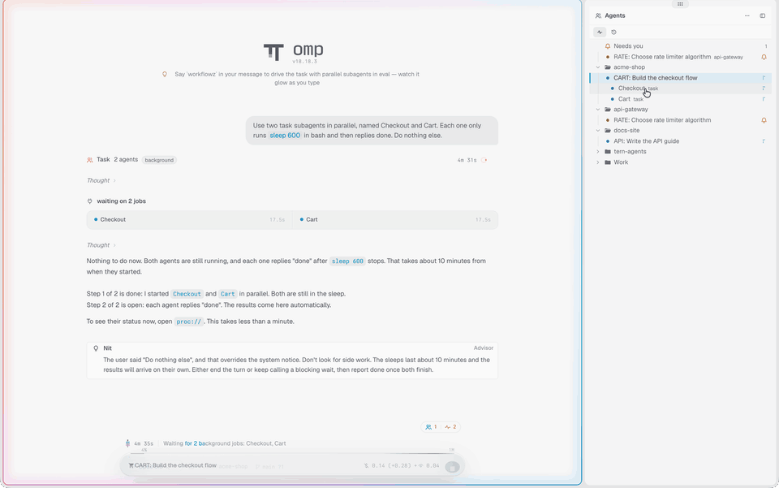

# Agent Deck

All your coding agents in one sidebar, in every Tern tab.

 



## ✨ Features

- 🚦 **Zones.** The Live view shows three zones in a fixed order: **Needs you**, **Working** and **Idle**. A zone with no agents does not show.
- 📁 **Agents by project.** Inside each zone, agents show under a light project label: the git repo, or the folder outside a repo. Worktrees and ovnfs checkouts go under their main repo.
- 🔔 **Needs you.** Each waiting agent is a card with its question (2 lines), its wait time and its project and tab, longest wait first. A waiting subagent gets its own card. The Live button shows how many agents need you. A status line segment counts the agents that work and wait, and a toast tells you when an agent off screen waits or finishes.
- ➖ **Quiet rows.** Each agent is one line: omp's title icon in the color of its state, the title, a strip with one bar per running subagent, and one time (turn timer, wait time or age).
- 🌳 **Subagents at every depth.** Click an agent's strip to show its subagent lines: each line shows its state, its name, what it does now and its time. Click a line to open that subagent in omp. A failed subagent always shows.
- 🪪 **Hover card.** Point at a row to see its state, tab, title, summary, model, effort, cost and subagent counts.
- 💲 **Cost.** The hover card shows what a session cost, its subagents included: money spent through API keys, and subscription use at API prices (not billed).
- ⏳ **Quota.** When every account of a provider is near its quota limit or at it, one line under the Live/Recent switch tells you which one and when it resets.
- 📌 **Pins.** Pin the chats that matter. Pins stay after a restart, and a stopped pin resumes with one click.
- 🕘 **History.** The Recent view lists your closed omp sessions by day (Today, Yesterday, This week, Earlier), then by project. One click resumes a session in a new tab.
- ➕ **New tab in a project.** The `+` on a project label opens a new tab there. It follows Tern's "New tabs and splits open" setting: a shell or your agent command.
- ✏️ **Rename.** Give an omp session a new title from its row.
- 📋 **Copy.** Copy the session ID or the path of any session file.
- 🏷️ **Tab titles.** Each tab takes the name of its main agent. A tab that you named keeps its name.
- 🎨 **Native look.** Every color, radius and font comes from Tern's theme, so the sidebar follows your theme: light or dark, square or round. Motion stops under reduced motion.

## 📦 Install

```sh
tern plugin install github.com/matteoantoci/tern-agent-deck
```

Requirements:

- **Tern 0.9.13** or later.
- **[omp](https://github.com/can1357/oh-my-pi)** for subagents, the Recent view, Rename and the copy items. Other agents that Tern lists (for example, Claude Code or Codex) show as rows with their state.

## 🖱️ Usage

The sidebar opens on the right edge of each tab. Press **⌥⌘A** to show or hide it everywhere.

### Clicks

| Click | Result |
| --- | --- |
| An agent row | Focuses that agent. It switches the session or brings a parked pane back. If omp shows a subagent, omp goes back to the main session. |
| A Needs you card | Goes to that agent so that you can answer, or shows that subagent in omp. |
| A pinned agent that stopped | Resumes its session in a new tab with `omp --resume`. The pin moves to the resumed agent. |
| The subagent strip after an agent's title (its bars, **N done** or **N subagents**) | Shows or hides that agent's subagent lines. This tab's agent starts with them shown. |
| A subagent line | Opens that subagent in omp's view. |
| `+` on a project label | Opens a new tab in that project. |
| **Older than a day** | Shows or hides the idle agents whose last turn ended more than 1 day ago. Pins and this tab's agent always show. |
| A session row (Recent) | Resumes the session in a new tab with `omp --resume`. |
| **Earlier** (Recent) | Shows or hides the sessions from before this week. |
| The status line segment | Focuses the agent that has waited longest. |
| The Live and Recent buttons | Switch the view. |

The accent color marks only this tab's agent (with its open subagent lines) and keyboard focus.

### Hover card

Point at a row to see its card:

- The state in its color, the time and the tab (for example `Working 4m · tab 6`).
- The title, then the last message. A long last message shows a short summary that omp's light model (`@smol`) writes: about 4 seconds after the turn ends, or, while the agent works, once its text stays the same for 15 seconds. Until a new summary arrives, the card keeps the one before.
- One muted line with the kind (omp, Claude Code, Codex), the model as `provider/model` with the effort, and whether it is pinned.
- The cost: `Spent $3.84` for API-key accounts, and a muted `≈ $33.61 at API prices` for subscription use. An agent that used both kinds shows both lines, spent first. The cost includes every subagent of the session and updates at each session scan. An agent that is not omp, or that has no cost yet, has no cost line.
- The subagent counts, for example `Subagents: 2 running · 1 done`.
- A hint with the click and right-click actions of the row.

A subagent line's card shows its state and time, its name, its whole current call, and its type, the agent it runs under, its model and effort.

### Quota line

Omp moves to another account of the same provider when one account reaches its limit. So the line shows a provider only when each of its accounts has a quota near its limit (warning) or at it (exhausted). For each such provider, the line shows the account with the most room, which omp uses next, with its worst quota, for example `Claude · 5h 97% · resets in 2h`. The account name shows only when the provider has 2 or more accounts. A warning square marks a warning, an error square marks an exhausted quota. The worst provider shows first, with `+N` for the other providers at risk. The tooltip lists every quota near or at its limit, of every account. The reset shows as a weekday when it is more than 24 hours away, and as `in 38m` otherwise. While no provider is at risk, the line does not show.

### Right-click menu

| Row | Items |
| --- | --- |
| A live agent | Pin or Unpin, Rename, Copy session ID, Copy session path, Interrupt |
| A subagent | Copy session ID, Copy session path |
| A closed session | Copy session ID, Copy session path |
| A pinned agent that stopped | Unpin, Rename (off), Copy session ID, Copy session path, Interrupt (off) |

Rename is available for running omp agents. It is off while omp shows a subagent and while the agent waits for your answer. omp adds an icon and a category to the new title, so the title changes after about half a minute. Rows and tab titles show omp's icon in front of the title.

### Keys and commands

| Key | Command palette |
| --- | --- |
| ⌥⌘A | Toggle Agents sidebar |
| | New tab in the focused agent's folder |
| | Arrange tabs by project |
| | Pin this agent |
| | Next waiting agent |

## ⚙️ How it works

- The plugin opens one canvas per tab, on the right edge.
- It reads Tern's agent list and omp's tray of subagents in each agent's dock, so a subagent that a message wakes again shows as running too. It sends events to an agent only when you click Interrupt, Rename, a subagent line, or an agent row while omp shows a subagent.
- It finds closed sessions in `~/.omp/agent/sessions`, and the session file of each live agent in `tern inspect --json`.
- It reads omp's `~/.omp/agent/agent.db` with `sqlite3 -readonly`, with each session scan (at most once a minute). Two queries only read: the latest use of each subscription quota (no account key), and the `id`, `provider` and `credential_type` of each credential (no secret). The plugin never writes the database.
- It reads the cost incrementally. For each live omp session, it lists the session file and its subagents' files, and reads only the bytes that each file added since the last read: the `usage.cost.total` and the `credentialId` of each assistant message. `api_key` credentials add to the money spent, `oauth` credentials to subscription use. The first read of a long session takes about 1 second, off the UI thread. A failed read shows no cost.
- It keeps pins, folds, open subagent lines, the view and the width in `tern.kv`. All windows share this state.
- It runs local commands only, with one exception: a long last message of an agent (up to 8,000 bytes) goes to the model of omp's `@smol` role, through omp, for the summary in the row's card. That model's provider receives the text.

## 🧭 Limitations

- Tern's API has no window-level panel, so each tab has its own copy of the sidebar. In a tab with splits, the sidebar sits beside the top-right pane and does not cover the full height.
- Subagents, the Recent view, Rename, the copy items, cost and quota need omp. Other agents show only as rows.
- The cost and the quota line need `sqlite3` (macOS has it in `/usr/bin`) and update only at the session scan's pace. Subscription use is an estimate at API prices, not a bill.
- A subagent's time counts from when the plugin first saw its state, so it restarts after a plugin reload. Subagents also need Tern's agents tray setting, which is on by default.
- Closed sessions have no Rename, because omp has no command for it.
- Tern adds its own **Copy** item at the end of each right-click menu. A plugin cannot remove it.
- A canvas takes no text input, so the sidebar has no search box. Use the command palette.
- Open requests to the Tern SDK: [#281](https://github.com/stencil-hq/tern-sdk/issues/281), [#178](https://github.com/stencil-hq/tern-sdk/issues/178), [#285](https://github.com/stencil-hq/tern-sdk/issues/285).

## 🛠️ Development

See [docs/development.md](docs/development.md) for the module map, the tests, the type check and how to link a checkout.

## 📄 License

[MIT](LICENSE) © 2026 Matteo Antoci
