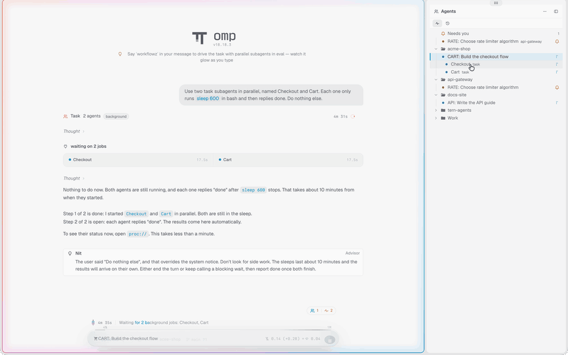

# Agent Deck

All your coding agents in one sidebar, in every Tern tab.

 



## ✨ Features

- 📁 **Agents by project.** Live agents show in groups by git repo, or by folder outside a repo.
- 🌳 **Subagents at every depth.** omp's subagents show under their agent. Click one to open it in omp. Click another to switch to it, or click the agent to go back to the main session.
- 🔔 **Needs you.** Agents that wait for you show first, in a "Needs you" strip. A status line segment counts the agents that work and wait, and a toast tells you when an agent off screen waits or finishes.
- 📌 **Pins.** Pin the chats that matter. Pins stay after a restart.
- 🕘 **History.** The Recent view lists your recent omp sessions by folder. One click resumes a session in a new tab.
- ➕ **New tab in a folder.** The `+` on a folder opens a new tab there. It follows Tern's "New tabs and splits open" setting: a shell or your agent command.
- ✏️ **Rename.** Give an omp session a new title from its row.
- 📋 **Copy.** Copy the session ID or the path of any session file.
- 🏷️ **Tab titles.** Each tab takes the name of its main agent. A tab that you named keeps its name.
- 🎨 **Native look.** The sidebar looks like Tern's Files pane and follows your theme, light or dark.

## 📦 Install

```sh
tern plugin install github.com/matteoantoci/tern-agent-deck
```

Requirements:

- **Tern 0.9.13** or later.
- **[omp](https://github.com/can1357/oh-my-pi)** for subagents, the Recent view, Rename and the copy items. Other agents that Tern lists (for example, Claude Code or Codex) show as rows with their state.

## 🖱️ Usage

The sidebar opens on the right edge of each tab. Press **⌥⌘A** to show or hide it everywhere.

### Clicks

| Click | Result |
| --- | --- |
| An agent row | Focuses that agent. It switches the session or brings a parked pane back. If omp shows a subagent, omp goes back to the main session. |
| A subagent row | Opens that subagent in omp's view. |
| A folder row | Folds or opens the folder. |
| `+` on a folder row | Opens a new tab in that folder. |
| **Older** | Shows or hides the idle agents of that folder whose last turn ended more than 1 day ago. |
| A session row (Recent) | Resumes the session in a new tab with `omp --resume`. |
| **N more** (Recent) | Shows all folders. **Show fewer** shows the first 5 again. |
| The status line segment | Focuses the agent that has waited longest. |
| The Live and Recent buttons | Switch the view. |
| ⋯ in the head | Opens a menu: New tab here, Arrange tabs by project, Toggle sidebar. |

Point at a row to see its card: the state, the model and its provider, the effort, the turn timer and the last message.

### Right-click menu

| Row | Items |
| --- | --- |
| A live agent | Pin or Unpin, Rename, Copy session ID, Copy session path, Interrupt |
| A subagent | Copy session ID, Copy session path |
| A closed session | Copy session ID, Copy session path |
| A pinned agent that is gone | Unpin |

Rename is available for omp agents. It is off while omp shows a subagent and while the agent waits for your answer. omp adds an icon and a category to the new title, so the title changes after about half a minute.

### Keys and commands

| Key | Command palette |
| --- | --- |
| ⌥⌘A | Toggle Agents sidebar |
| | New tab in the focused agent's folder |
| | Arrange tabs by project |
| | Pin this agent |
| | Next waiting agent |

## ⚙️ How it works

- The plugin opens one canvas per tab, on the right edge.
- It reads Tern's agent list and the task cards of omp's native view. It sends events to an agent only when you click Interrupt, Rename, a subagent row, or an agent row while omp shows a subagent.
- It finds closed sessions in `~/.omp/agent/sessions`, and the session file of each live agent in `tern inspect --json`.
- It keeps pins, folds, the view and the width in `tern.kv`. All windows share this state.
- It runs only local commands. No data leaves your machine.

## 🧭 Limitations

- Tern's API has no window-level panel, so each tab has its own copy of the sidebar. In a tab with splits, the sidebar sits beside the top-right pane and does not cover the full height.
- Subagents, the Recent view, Rename and the copy items need omp. Other agents show only as rows.
- Closed sessions have no Rename, because omp has no command for it.
- Tern adds its own **Copy** item at the end of each right-click menu. A plugin cannot remove it.
- A canvas takes no text input, so the sidebar has no search box. Use the command palette.
- Open requests to the Tern SDK: [#281](https://github.com/stencil-hq/tern-sdk/issues/281), [#178](https://github.com/stencil-hq/tern-sdk/issues/178), [#285](https://github.com/stencil-hq/tern-sdk/issues/285).

## 🛠️ Development

See [docs/development.md](docs/development.md) for the module map, the tests, the type check and how to link a checkout.

## 📄 License

[MIT](LICENSE) © 2026 Matteo Antoci
